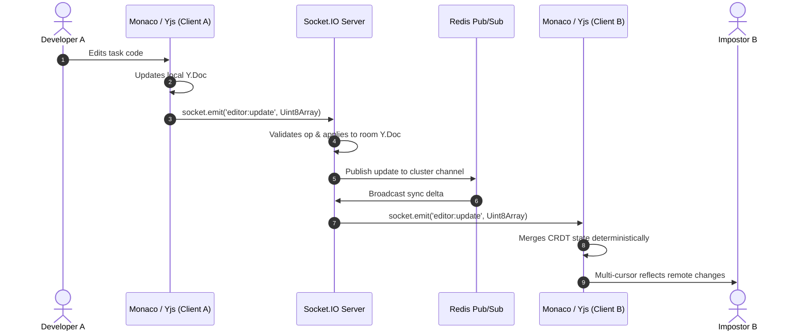
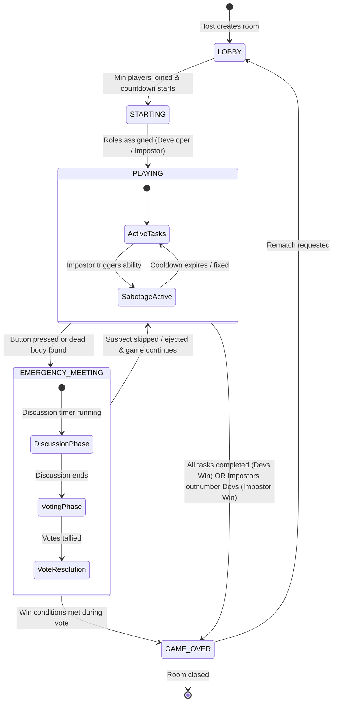

# Devception — Architecture & Technical Specifications

This document outlines the system architecture, real-time collaboration engine, and state machines powering **Devception**.

---

## 1. High-Level Architecture Overview

Devception employs a decoupled client-server architecture with distributed synchronization:

```
┌────────────────────────────────────────────────────────┐
│                   Next.js 14 Client                    │
│  (Monaco Editor + Y-Monaco + Socket.io + Tailwind CSS) │
└───────────▲────────────────────────────────┬───────────┘
            │                                │
      HTTP / REST API                  WebSocket / Yjs
  (Auth, Profiles, History)          (Real-time Game Loop)
            │                                │
┌───────────▼────────────────────────────────▼───────────┐
│                   Express 5 Server                     │
│    (Socket.io Engine + Code Judge + Auth Middleware)    │
└───────────┬────────────────────────────────┬───────────┘
            │                                │
     Mongoose Models                  Redis Pub/Sub
            ▼                                ▼
┌───────────────────────┐        ┌───────────────────────┐
│     MongoDB 7.0       │        │       Redis 7.0       │
│  (Persistent Storage) │        │ (Horizontal Scaling)  │
└───────────────────────┘        └───────────────────────┘
```

---

## 2. Real-Time Collaborative Editor & CRDT Sync

Devception utilizes **Yjs** (Conflict-free Replicated Data Type) paired with Monaco Editor to guarantee eventual consistency across all players without race conditions:



---

## 3. Game State Machine

Each room runs a deterministic state machine managed on the server:



---

## 4. Socket.IO Event Reference

### Lobby & Room Management
| Event Name | Direction | Payload | Description |
| :--- | :--- | :--- | :--- |
| `room:create` | Client → Server | `{ settings }` | Creates a new game room with custom rules |
| `room:join` | Client → Server | `{ roomCode }` | Joins an existing game room |
| `room:state` | Server → Client | `{ roomCode, players, phase, settings }` | Full room state synchronization |
| `room:leave` | Client → Server | `{ roomCode }` | Gracefully leaves room |

### Collaborative Editor & Tasks
| Event Name | Direction | Payload | Description |
| :--- | :--- | :--- | :--- |
| `editor:sync-step-1` | Client → Server | `{ roomCode, stateVector }` | Requests initial state delta |
| `editor:update` | Bidirectional | `{ roomCode, update: Uint8Array }` | Binary CRDT document patch |
| `task:submit` | Client → Server | `{ roomCode, taskId, code }` | Submits task code for server validation |
| `task:progress` | Server → Client | `{ completed, total, percentage }` | Broadcasts team completion rate |

### Emergency Meetings & Voting
| Event Name | Direction | Payload | Description |
| :--- | :--- | :--- | :--- |
| `meeting:call` | Client → Server | `{ roomCode }` | Triggers emergency discussion phase |
| `meeting:vote` | Client → Server | `{ roomCode, targetUserId }` | Submits anonymous vote |
| `meeting:ejection` | Server → Client | `{ ejectedUserId, wasImposter }` | Broadcasts ejection results |
